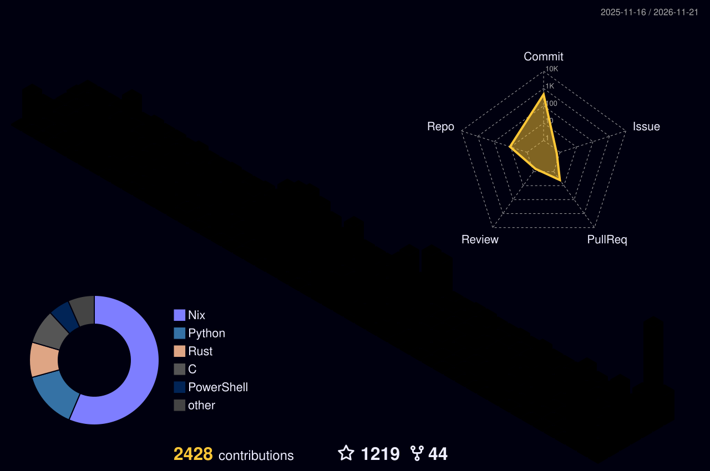

  

  <b>Offensive Security Consultant</b> · Malmö, Sweden 
  Penetration testing across web apps, APIs, Active Directory, cloud, IoT and mobile.

  
  
  
  
  
   
  
  
  

## About me

I find vulnerabilities and simulate real attacks so organisations can fix what matters, then turn the findings into remediation that teams can actually carry out. I lead security assessments, write custom exploits and tooling, and mentor junior testers.

I came to security through software engineering, and it still shapes how I work: I look at control flow and architecture before payloads. Many of the bugs I find come from understanding how a system was meant to work and where that intent breaks down.

**What I work on**

- **Penetration testing:** web applications, APIs, networks, Active Directory, IoT, and AWS, Azure and GCP
- **Exploitation and post-exploitation:** privilege escalation, credential access, lateral movement, defence evasion
- **Red teaming:** C2 infrastructure and OPSEC (Sliver, custom frameworks)
- **Vulnerability research and tooling:** when the right tool does not exist yet, I write it in Go, Rust, Python or PowerShell

## Certifications

- **CPTS**, Certified Penetration Testing Specialist (Hack The Box, 2025)
- **MCRTA**, Multi-Cloud Red Teaming Analyst (CyberWarfare Labs, 2025)
- **CyberOps Associate** (Cisco, 2021)
- **BSc Software Engineering**, University of Gothenburg (2023)

## Research

- 🏆 **Best Research Paper Award**, PROFES 2024 (25th International Conference on Product-Focused Software Process Improvement)
- **Empowering Software Engineers to Design More Secure Web Applications: Guidelines and Potential of Using LLMs as a Recommender Tool.** R. Groner, K. Svensson, D. Axelrod, R. Khojah, M. Mohamad, R. Wohlrab. *Journal of Software: Evolution and Process*, 2026. [doi:10.1002/smr.70083](https://doi.org/10.1002/smr.70083)
- **Guidelines for Supporting Software Engineers in Developing Secure Web Applications.** K. Svensson, D. Axelrod, M. Mohamad, R. Wohlrab. *Product-Focused Software Process Improvement (PROFES)*, 2025. [doi:10.1007/978-3-031-78386-9_9](https://doi.org/10.1007/978-3-031-78386-9_9)

## The notebook

[**Ramblings of a Professional Hacker**](https://drakeaxelrod.dev/notes) is my working reference for offensive security: methodology, tooling and techniques, written the way I would explain them to a colleague. Everything is anonymised and NDA compliant.

| Area | What is in there |
| --- | --- |
| [Active Directory](https://drakeaxelrod.dev/notes/active-directory) | [Kerberoasting](https://drakeaxelrod.dev/notes/active-directory/kerberoasting), [AS-REP roasting](https://drakeaxelrod.dev/notes/active-directory/asrep-roasting), [NTLM relay](https://drakeaxelrod.dev/notes/active-directory/ntlm-relay), [ACL abuse](https://drakeaxelrod.dev/notes/active-directory/acl-abuse), [KrbRelayUp](https://drakeaxelrod.dev/notes/active-directory/krbrelayup), silver tickets, DNSAdmins |
| [Windows](https://drakeaxelrod.dev/notes/windows) | [SeImpersonate](https://drakeaxelrod.dev/notes/windows/seimpersonate-privilege), [BYOVD](https://drakeaxelrod.dev/notes/windows/byovd), [PrintNightmare](https://drakeaxelrod.dev/notes/windows/printnightmare), service hijacking, DLL injection, privileged groups |
| [Linux](https://drakeaxelrod.dev/notes/linux) | [sudo misconfigurations](https://drakeaxelrod.dev/notes/linux/sudo-misconfigurations), [capabilities](https://drakeaxelrod.dev/notes/linux/capabilities), [wildcard abuse](https://drakeaxelrod.dev/notes/linux/wildcard-abuse), shared object and Python library hijacking, kernel exploits |
| [Web](https://drakeaxelrod.dev/notes/web) | [SQL injection](https://drakeaxelrod.dev/notes/web/sql-injection), [business logic flaws](https://drakeaxelrod.dev/notes/web/business-logic-flaws), [insecure deserialization](https://drakeaxelrod.dev/notes/web/insecure-deserialization), [host header poisoning](https://drakeaxelrod.dev/notes/web/host-header-poisoning), API security, auth bypass |
| [Cloud](https://drakeaxelrod.dev/notes/cloud) | AWS, Azure and Entra ID, and GCP assessment and IAM privilege escalation |
| [Mobile](https://drakeaxelrod.dev/notes/mobile) | Android and iOS app analysis, [Frida](https://drakeaxelrod.dev/notes/mobile/frida), Objection, [SSL pinning bypass](https://drakeaxelrod.dev/notes/mobile/ssl-pinning-bypass) |
| [Network](https://drakeaxelrod.dev/notes/network) | SMB, SSH, RDP, DNS, SMTP, FTP, WebDAV and SQL services |
| [Tools](https://drakeaxelrod.dev/notes/tools) | [BloodHound](https://drakeaxelrod.dev/notes/tools/bloodhound), [Impacket](https://drakeaxelrod.dev/notes/tools/impacket), [NetExec](https://drakeaxelrod.dev/notes/tools/netexec), [Sliver](https://drakeaxelrod.dev/notes/tools/sliver), [Ligolo-ng](https://drakeaxelrod.dev/notes/tools/ligolo-ng), Mimikatz, Hashcat |
| More | [Containers](https://drakeaxelrod.dev/notes/containers), [defence evasion](https://drakeaxelrod.dev/notes/evasion), [AI security](https://drakeaxelrod.dev/notes/ai), [macOS](https://drakeaxelrod.dev/notes/macos) |

## Tools I've built

| Project | What it does |
| --- | --- |
| [suidchk](https://github.com/drakeaxelrod/suidchk) | Rust CLI that finds SUID binaries and shows how each one could be used for privilege escalation |
| [Invoke-CheckServiceHijack](https://github.com/drakeaxelrod/Invoke-CheckServiceHijack) | PowerShell audit for Windows services whose executables are writable by Everyone |
| [dev-console-ptest-script](https://github.com/drakeaxelrod/dev-console-ptest-script) | Penetration testing helpers you load straight into the browser dev console |
| [portal_c2_demo](https://github.com/drakeaxelrod/portal_c2_demo) | Command and control framework demo in Go, gRPC and Wails |
| [cvss.typ](https://github.com/drakeaxelrod/cvss.typ) · [cvssc](https://github.com/drakeaxelrod/cvssc) | Typst packages that calculate CVSS 2.0, 3.x and 4.0 scores for reports |

## Skills

| Area | What I work with |
| --- | --- |
| Web and API | Burp Suite, ffuf, SQLMap. Injection, deserialization, SSRF, access control and business logic flaws. OAuth/OIDC, SAML and JWT. |
| Active Directory and Windows | BloodHound, Impacket, NetExec, Responder, Mimikatz, PowerView. Kerberos attacks, NTLM relay, ACL abuse and privilege escalation. |
| Cloud | AWS, Azure and Entra ID, GCP. IAM privilege escalation and configuration review. |
| Mobile | Frida, Objection and MobSF on Android and iOS. Certificate pinning and attestation bypass. |
| Red team and evasion | Sliver and custom C2 payloads. AMSI, AppLocker and EDR evasion, including BYOVD. |
| Exploits and tooling | Go, Rust, C, C++, Python and PowerShell. |
| Network and infrastructure | Nmap, Wireshark, Nessus, Metasploit, Ligolo-ng, Hashcat, John the Ripper. |
| Containers | Docker and Kubernetes. |
| Reporting | Typst, CVSS 3.1 and 4.0, CWE. |

**Languages and platforms**

  

  

**Frameworks and standards:** OWASP (WSTG, ASVS, MASVS, MASTG, Top 10), MITRE ATT&CK, PTES, NIST SP 800-115, CVSS, CWE, CAPEC

## Activity

